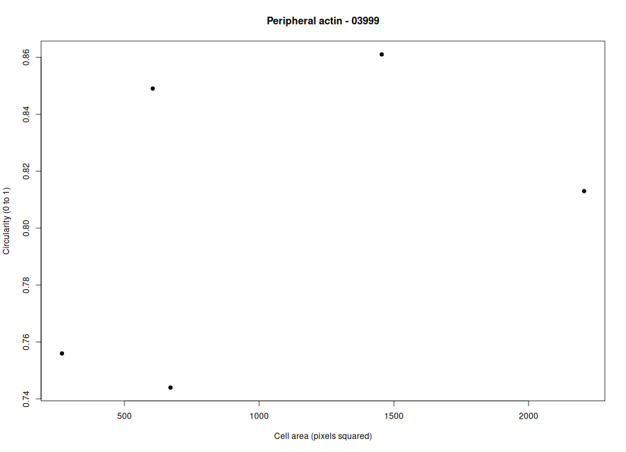
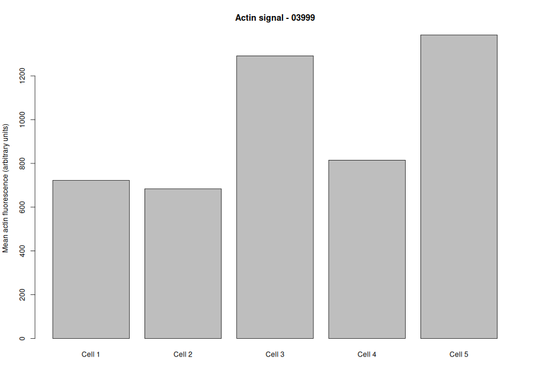

# Cytoskeleton and Cell Morphology

**Student ID:** 202400722

## Dataset

The images used in this project come from the BBBC018 dataset in the Broad Bioimage Benchmark Collection (BBBC).

- **Dataset & Website:** BBBC018. https://bbbc.broadinstitute.org/BBBC018
- **Cell Line:** HT29 human colon cancer cells
- **Selected Field ID:** 03999
- **Selected Phenotype:** Peripheral actin
- **Actin Image:** `03999-actin.DIB`
- **DNA Image:** `03999-DNA.DIB`
- **Additional Image Available:** `03999-pH3.DIB`
- **Number of Cells Measured:** 5

The actin image was used to examine the distribution of actin fluorescence around the cells, while the DNA and ph3 images provided additional visual context for identifying individual cells.

Dataset attribution: We used image set BBBC018v1 from the Broad Bioimage Benchmark Collection (BBBC) (Ljosa et al., Nature Methods, 2012).

## Selected Phenotype: Peripheral Actin

The selected phenotype is Peripheral actin, characterized in this analysis by relatively strong actin fluorescence near the cell edges. In the selected field, several cells appeared rounded or oval, with brighter peripheral outlines and relatively darker centers. This visual pattern supported choosing Peripheral actin as the phenotype for further analysis. The phenotype selection was based on visual inspection of the fluorescence image. Measurements from five cells were used for the quantitative analysis.

## Methods

**1. Image Selection:**

The actin and DNA images corresponding to field 03999 were selected from the BBBC018 dataset and opened using Fiji (ImageJ).

**2. Cell Measurement in Fiji:**

Five cells were selected and traced using the Freehand Selection tool. The selected regions of interest were added to the ROI Manager and measured.

The measurements included:

- Area: The area of each selected cell.
- Mean gray value: The average image intensity within the selected region.
- Shape descriptors: Measurements used to describe cell shape, including circularity and aspect ratio where available.

The measurements were exported as a CSV file for analysis in R.

**3. Data Analysis in R:**

The Fiji measurements were imported into R using the `read.csv()` function. Summary statistics were calculated for the five measured cells. The analysis included mean cell area, mean circularity, mean aspect ratio, and mean actin fluorescence intensity. Two plots were generated to visualize cell morphology and fluorescence intensity.

## Results and Figures

**Figure 1.** *Cell Area vs. Circularity.*

This plot shows the relationship between the measured cell area and circularity for the five selected cells. Circularity describes how closely a cell's shape resembles a perfect circle, with values closer to 1 indicating a more circular shape.

**Figure 2.** *Mean Actin Fluorescence Intensity.*

This plot compares the mean actin fluorescence intensity of the five measured cells. The mean gray value represents the average image intensity within each selected cell region.

## Discussion Questions:

**1. Which specific phenotype did you choose, and what visible features support that choice?**

- The Peripheral actin phenotype was selected because several cells showed brighter actin fluorescence near their edges and relatively darker centers. This distribution suggested that actin signal was concentrated toward the cell periphery in the selected field.

**2. Were your five cells mostly round or elongated? Refer to your circularity and aspect-ratio results.**

- Circularity describes how closely a cell resembles a circle. Values closer to 1 indicate a more circular shape, while lower values indicate a less circular or more irregular shape. Aspect ratio describes the relationship between a cell's major and minor dimensions. A value closer to 1 indicates a more rounded shape, while a larger value indicates a more elongated shape.

**3. What role does actin play in maintaining cell shape and in cell movement (Karp Chapter 9)?**

- Actin is part of the cytoskeleton and helps support cell shape. Changes in actin organization can contribute to cell spreading, shape changes, adhesion, and movement. The distribution of actin fluorescence can therefore provide information about the structural organization of cells.

**4. Why can a single fixed fluorescence image NOT show how fast a cell moves?**

- Fixed fluorescence microscopy images capture cells at a particular point in time. They can show cell shape and the distribution of labeled structures, but they cannot directly measure movement speed because they do not show how a cell's position changes over time. Measuring movement speed requires time-lapse imaging or another method that tracks cell movement across multiple time points.

## Tools Used:

- **Fiji (ImageJ):** Image visualization, cell selection, and measurement.
- **R:** Data processing, summary statistics, and plotting.
- **GitHub:** Project organization, version control, and sharing results.

## References:

Ljosa, V., Sokolnicki, K. L., & Carpenter, A. E. (2012). Annotated high-throughput microscopy image sets for validation. *Nature Methods, 9*, 637. https://doi.org/10.1038/nmeth.2083

Broad Bioimage Benchmark Collection (BBBC). BBBC018. https://bbbc.broadinstitute.org/BBBC018
